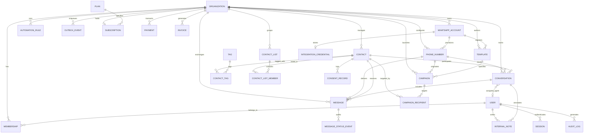

# CONVOZA — Database Architecture & Schema Documentation

> **Database Engine:** PostgreSQL 16  
> **ORM & Migration Tool:** Prisma ORM  
> **Primary Key Standard:** UUIDv4  
> **Timestamp Standard:** UTC (`DateTime @default(now())`)  
> **Credential Storage:** AES-256-GCM Encrypted Payloads

---

## 1. Entity-Relationship Diagram (ERD)



---

## 2. Table Specifications & Indexing Strategy

### 2.1 Multi-Tenancy Core
- **`organizations`**: Master tenant entity. UUID primary key, unique `slug`, `isSuspended` flag with suspension audit reasons.
- **`memberships`**: Relates `User` to `Organization`. Composite unique constraint `[organizationId, userId]` with roles (`SUPER_ADMIN`, `ORG_OWNER`, `ORG_ADMIN`, `MANAGER`, `AGENT`, `VIEWER`).
- **`sessions`**: Refresh token rotation storage with user agent and IP audit data.

### 2.2 WhatsApp Asset Infrastructure
- **`whatsapp_accounts`**: Tracks Meta WABA ID, onboarding method (`EMBEDDED_SIGNUP` vs `MANUAL`), and webhook subscription timestamp.
- **`integration_credentials`**: Stores Meta permanent access tokens encrypted with AES-256-GCM. Plaintext tokens are never stored.
- **`phone_numbers`**: Stores Meta `phoneNumberId`, verified display name, quality rating (`GREEN`, `YELLOW`, `RED`), and messaging limit tier (`TIER_1K`, `TIER_10K`, etc.).

### 2.3 Contacts & Audience Isolation
- **`contacts`**: Unique index on `[organizationId, phone]`. Enforces E.164 phone standard. Holds `consentStatus` (`OPTED_IN`, `OPTED_OUT`, `PENDING`) and `consentSource`.
- **`consent_records`**: Immutable audit log of every consent update or STOP opt-out event with timestamp, IP, and source.
- **`contact_lists` & `contact_list_members`**: Audience segment containers.
- **`tags` & `contact_tags`**: Fast categorical labels for filtering and automation triggers.

### 2.4 WhatsApp Templates
- **`templates`**: Meta approved message template specifications. Composite unique constraint `[organizationId, name, language]` prevents collisions. Stores components (Header, Body with dynamic tokens `{{1}}`, Footer, Buttons).

### 2.5 Messaging & Shared Inbox
- **`conversations`**: Unique index on `[organizationId, phoneNumberId, contactId]`. Stores `customerWindowExpiresAt` to enforce WhatsApp's 24-hour customer service window, `assignedToUserId`, and `unreadCount`.
- **`messages`**: Incoming and outgoing WhatsApp messages. Unique index on Meta `wamid`. Indexed on `[organizationId, conversationId]`, `status`, and `createdAt`.
- **`message_status_events`**: Append-only log of delivery receipts (`SENT`, `DELIVERED`, `READ`, `FAILED`) received via Meta Cloud API webhooks.
- **`internal_notes`**: Private collaboration notes between agents on a conversation thread.

### 2.6 Bulk Campaigns
- **`campaigns`**: High-volume broadcast definitions. Tracks live counters: `totalRecipients`, `queuedCount`, `sentCount`, `deliveredCount`, `readCount`, `failedCount`, and `repliedCount`.
- **`campaign_recipients`**: Join table of target contacts per campaign. Indexed on `[campaignId, status]`.

### 2.7 Transactional Outbox Queue
- **`outbox_events`**: Relational queue for asynchronous worker execution.
  - Columns: `id`, `organizationId`, `type`, `payload (JSONB)`, `status` (`PENDING`, `PROCESSING`, `COMPLETED`, `FAILED`, `DEAD_LETTER`), `attempts`, `maxAttempts`, `scheduledFor`, `lockedAt`, `lockedBy`, `idempotencyKey`.
  - Composite Index: `[status, scheduledFor]` enables rapid index-scanned worker claims with `FOR UPDATE SKIP LOCKED`.

---

## 3. Database Migration & Seeding Commands

```bash
# Generate Prisma Client
npm run prisma:generate --workspace=@convoza/api

# Apply Database Migrations
npm run prisma:migrate --workspace=@convoza/api

# Execute Database Seed Script
npm run prisma:seed --workspace=@convoza/api
```
