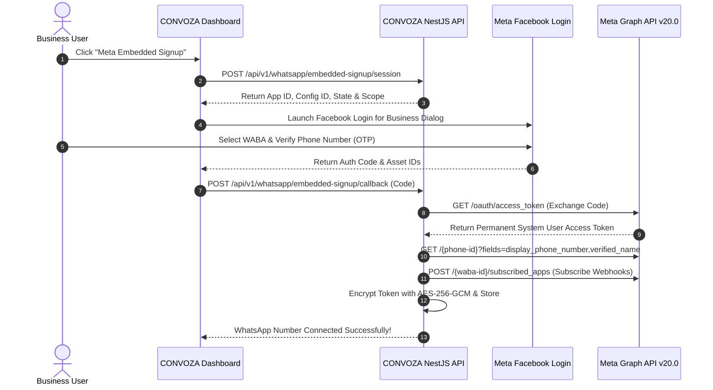

# CONVOZA — Meta WhatsApp Business Platform Integration Guide

> **Target Platform:** Official Meta WhatsApp Business Cloud API  
> **API Version:** Graph API v20.0  
> **Documentation Scope:** Embedded Signup, Manual Credentials, Webhooks & App Review

---

## 1. Prerequisites on Meta for Developers

To connect your business WhatsApp assets or onboard clients as a Meta Tech Provider:

1. Create a Meta for Developers account at [developers.facebook.com](https://developers.facebook.com).
2. Register a Meta App under the **Business** app type.
3. Add the **WhatsApp** product to your app.
4. Complete Meta Business Verification for your organization in Meta Business Manager.

### Required Permissions
- `whatsapp_business_management`: Allows CONVOZA to list and manage WABAs, phone numbers, templates, and webhooks.
- `whatsapp_business_messaging`: Allows CONVOZA to dispatch outbound messages and receive delivery receipts.

---

## 2. Onboarding Method A: Meta Embedded Signup

CONVOZA implements Meta Embedded Signup to deliver a frictionless 2-minute connection wizard without requiring customers to navigate complex developer dashboards.

### Flow Diagram



---

## 3. Onboarding Method B: Manual Connection

For enterprises possessing pre-existing System User tokens or custom WABA assets:

1. Navigate to **WhatsApp Numbers** -> **Manual Connection** in the dashboard.
2. Provide:
   - **Connection Name** (e.g. *Apex Retail Official*)
   - **WhatsApp Business Account (WABA) ID** (found in WhatsApp Manager)
   - **Phone Number ID** (distinct from the display phone number)
   - **System User Permanent Access Token**
3. Click **Validate Against Meta API**:  
   CONVOZA issues a real server-side request to:
   ```
   GET https://graph.facebook.com/v20.0/{phone-number-id}?fields=display_phone_number,verified_name,quality_rating,messaging_limit_tier
   ```
4. Upon successful validation, the access token is encrypted with AES-256-GCM and stored. Plaintext tokens are never written to disk or exposed in the UI.

---

## 4. Webhook Configuration & HMAC Verification

### 4.1 Challenge Verification
Meta verifies your webhook endpoint by sending a GET request:
```
GET /api/v1/webhooks/meta/whatsapp?hub.mode=subscribe&hub.challenge=1158201444&hub.verify_token=convoza_meta_verify_token_secure_2026
```
CONVOZA validates that `hub.verify_token` matches the configured environment token and immediately replies with `hub.challenge` as plain text (HTTP 200 OK).

### 4.2 Signature Verification
Every inbound payload from Meta contains an `X-Hub-Signature-256` header:
```
X-Hub-Signature-256: sha256=9ef470a252e449dd52f1c0103980004e09a3a0d1516ac75a8c6037081ff73a9c
```
CONVOZA computes the HMAC SHA-256 of the raw request body using your `META_APP_SECRET` and performs a timing-safe byte equality check to eliminate timing attacks.

### 4.3 Webhook Events Processed
- **`messages`**: Inbound customer texts, button clicks, images, and audio. Resets the 24-hour customer service window.
- **`statuses`**: Delivery status receipts (`sent`, `delivered`, `read`, `failed`). Updates message records and broadcasts live checkmarks via Socket.IO.
- **`message_template_status_update`**: Changes in template approval status (`APPROVED`, `REJECTED`, `PAUSED`).

---

## 5. Meta App Review Guidelines

When submitting your Meta App for live public onboarding (Tech Provider role), request:
1. **`whatsapp_business_management`**: Provide a screencast of the CONVOZA Template Builder and Phone Numbers dashboard showing asset synchronization.
2. **`whatsapp_business_messaging`**: Provide a screencast of the Shared Team Inbox and Campaign Wizard dispatching messages to test numbers.
