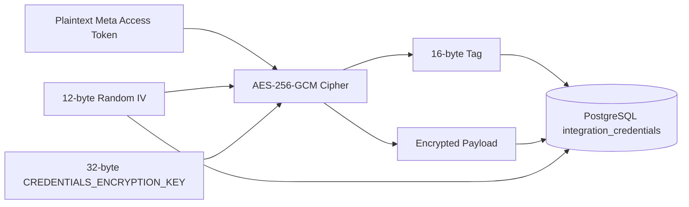

# CONVOZA — Security Architecture & Threat Model

> **Security Standard:** SOC2 & ISO-27001 Preparedness  
> **Encryption at Rest:** AES-256-GCM (Tokens & Secrets), Transparent Disk Encryption  
> **Encryption in Transit:** TLS 1.3 / HTTPS (Nginx Edge)  
> **Password Hashing:** Argon2id / bcrypt (Work Factor: 12)

---

## 1. Cryptographic Key Management & Credential Storage

### 1.1 AES-256-GCM Token Encryption
Meta permanent system user access tokens and third-party API credentials are never stored in plaintext. They are encrypted using Authenticated Encryption with Associated Data (AEAD) under `AES-256-GCM`:

- **Initialization Vector (IV):** A 12-byte cryptographically secure pseudorandom number generated uniquely for each write (`crypto.randomBytes(12)`).
- **Authentication Tag:** A 16-byte authentication tag generated by the cipher to detect ciphertext tampering or corruption.
- **Stored Format:** `iv_hex:authTag_hex:ciphertext_hex` stored in `integration_credentials.encryptedToken`.
- **Decryption:** Performed only in memory within the NestJS API or worker execution context right before issuing an authorized Meta Graph API call.

---

## 2. Authentication, Session Security & Refresh Token Rotation

### 2.1 Access Tokens vs Refresh Tokens
- **Access Tokens:** Signed with HMAC-SHA256 (`JWT_SECRET`), short-lived (15 minutes), containing user ID and organization scope.
- **Refresh Tokens:** High-entropy cryptographically random strings (40 bytes hex) stored in the `sessions` table with an expiration timestamp (7 days).

### 2.2 Refresh Token Rotation (RTR)
When a refresh token is presented:
1. The session is validated and verified for expiry.
2. A new token pair (new access token + new refresh token) is issued.
3. The database session record is immediately rotated with the new token.
4. Old refresh tokens are invalidated immediately. If an old refresh token is reused, all sessions associated with that user are revoked to protect against token theft.

---

## 3. Strict Multi-Tenancy & Authorization (RBAC)

### 3.1 Tenant Verification Guard
Every request to a tenant-owned resource passes through `TenantGuard`:
- Validates that the authenticated user holds an active membership in the organization.
- Rejects any cross-tenant probing with `403 Forbidden`.
- Checks organization suspension flags (`isSuspended`). If suspended, non-super-admin requests are rejected.

### 3.2 Role Hierarchy
Permissions are hierarchical:
$$\text{SUPER\_ADMIN (100)} > \text{ORG\_OWNER (80)} > \text{ORG\_ADMIN (60)} > \text{MANAGER (40)} > \text{AGENT (20)} > \text{VIEWER (10)}$$

---

## 4. Webhook Integrity & Signature Verification

### 4.1 Meta Webhooks
- Incoming webhooks are evaluated against the `X-Hub-Signature-256` header.
- The raw request body is hashed using HMAC SHA-256 with `META_APP_SECRET`.
- Comparison is executed via `crypto.timingSafeEqual` to eliminate timing attacks.

### 4.2 Razorpay Webhooks
- Evaluated against `x-razorpay-signature` using the configured `RAZORPAY_WEBHOOK_SECRET`.
- Ensures payments cannot be faked through browser redirects.

---

## 5. Network & Edge Security

- **Rate Limiting:** Nginx restricts API traffic to 100 requests/second per IP address (`burst=50`), and webhook ingestion to 250 requests/second (`burst=200`).
- **Database Boundary:** PostgreSQL is placed inside the isolated Docker internal network (`convoza_internal_net`) and is never mapped to host ports in production.
- **Non-Root Execution:** All Docker containers run under dedicated unprivileged runtime users (`nestjs`, `nextjs`, `worker`).

